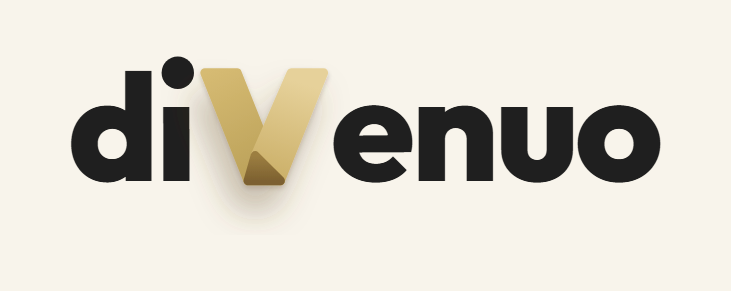

# gavia-vision

Parte de Gavia, un dron salvavidas autónomo con IA.

Detección de ahogamientos con visión artificial para un dron salvavidas autónomo. Corre en una
laptop sin internet y le da órdenes al dron por MAVLink.

> Prototipo experimental en desarrollo. No es un equipo de rescate certificado y no reemplaza a
> un guardavidas. Cualquier prueba con personas se hace con guardavidas presentes y un piloto de
> seguridad que puede tomar el control del dron.

## La idea

En las playas de la Costa Atlántica argentina, una persona que se ahoga casi nunca pide ayuda. Queda
vertical, con la boca al ras del agua, y en menos de un minuto puede hundirse. El guardavidas tiene
que verla, bajar de la torre, correr y nadar.

El sistema mira el mar con una cámara fija en la torre. Cuando detecta a alguien con el patrón de
ahogamiento, despega un dron que vuela solo hasta la persona y se posa en el agua a su lado. El dron
es el salvavidas: un aro de espuma que flota y del que la persona se agarra. El guardavidas sale
igual al rescate desde el primer segundo, con su tabla o su torpedo. El dron solo llega antes y
mantiene a la persona a flote hasta que él llega.

## Qué hace este repo

Es el "cerebro" del sistema, en Python:

| Módulo | Qué hace |
|---|---|
| `ojo` | Lee el video de la cámara fija (en el prototipo, un iPhone usado como webcam) |
| `deteccion` | Encuentra a las personas que están en el agua |
| `seguimiento` | Sigue a cada persona en el tiempo y calcula la probabilidad de que se esté ahogando |
| `ubicacion` | Pasa la posición en la imagen a una coordenada GPS, con la cámara calibrada |
| `estados` | Decide qué hacer: despegar, esperar al costado, posarse o volver |
| `piloto` | Le manda los comandos al dron (ArduPilot) por MAVLink |
| `botonera` | Habla por cable con la botonera del guardavidas |

## Cómo decide

1. Si la probabilidad de ahogamiento pasa un umbral, el dron despega solo y la botonera de la torre
   empieza a sonar. También despega si alguien que flotaba deja de verse y no vuelve a aparecer,
   porque quien se ahoga en silencio puede hundirse sin haber chapoteado.
2. El dron vuela hasta la persona y espera en el aire a su costado, nunca encima de ella, con luz y
   sirena que le marcan al guardavidas dónde está.
3. En la botonera hay dos botones. "Incidente real" hace que el dron se pose al lado de la persona
   en el momento, y "Falso positivo" lo manda de vuelta a la base.
4. Si nadie toca nada y la probabilidad sigue alta, el dron se posa al terminar una cuenta
   regresiva. Lo más probable es que el guardavidas ya haya salido corriendo.

Hay un modo 100% automático que se posa sin esperar a nadie. Es experimental y puede posarse al lado
de alguien que estaba bien.

Todo corre local, sin internet. La decisión de despegar y de posarse la toma una máquina de estados
con reglas fijas. La IA solo estima probabilidades, y ningún modelo de lenguaje interviene.

## Estado

En diseño. Todavía no hay código funcional. La estructura de módulos ya está armada.

El detector va a ser YOLO11n de [Ultralytics](https://github.com/ultralytics/ultralytics), detrás de
una interfaz chica que deja cambiarlo por otro. Por ahora se entrena con datasets públicos de
personas en el mar ([SeaDronesSee](https://github.com/Ben93kie/SeaDronesSee) y
[MOBDrone](https://aimh.isti.cnr.it/?p=4025)) y con escenas sintéticas de la vista desde la torre.
Ningún número de esas pruebas vale como precisión en una playa real: eso sale de simulacros con
guardavidas.

## Repos del proyecto

- [gavia-vision](https://github.com/LucioFex/gavia-vision): detección y lógica de decisión (este repo)
- [gavia-firmware](https://github.com/LucioFex/gavia-firmware): botonera ESP32 y configuración de ArduPilot
- [gavia-hardware](https://github.com/LucioFex/gavia-hardware): modelos 3D y lista de materiales

## Desarrollo

```bash
python -m venv .venv
source .venv/bin/activate   # en Windows: .venv\Scripts\activate
pip install -e ".[dev]"
pytest
```

## Con el apoyo de diVenuo

<a href="https://divenuo.com"></a>

Gavia es un proyecto del equipo, liderado por Luciano Esteban, con el apoyo de
[diVenuo](https://divenuo.com). diVenuo no vende ni certifica el dron.

El nombre y el logo de diVenuo no entran en la licencia de este repo. Para usarlos en una versión
propia de Gavia hace falta permiso.

## Licencia

[AGPL-3.0](LICENSE) (versión 3 o posterior). Copyright 2026 Luciano Esteban y Elías Espinosa.

Hasta el 2026-10-31 el repo era Apache-2.0. Pasó a AGPL porque usa Ultralytics YOLO, que tiene esa
licencia y la extiende a los modelos que se entrenan con él. Quien distribuya una versión adaptada
de gavia-vision tiene que publicar su código con la misma licencia. Los otros repos de Gavia siguen
con licencias permisivas.

## Autores

- Luciano Esteban ([@LucioFex](https://github.com/LucioFex))
- Elías Espinosa
- Augusto Valles (datos)
